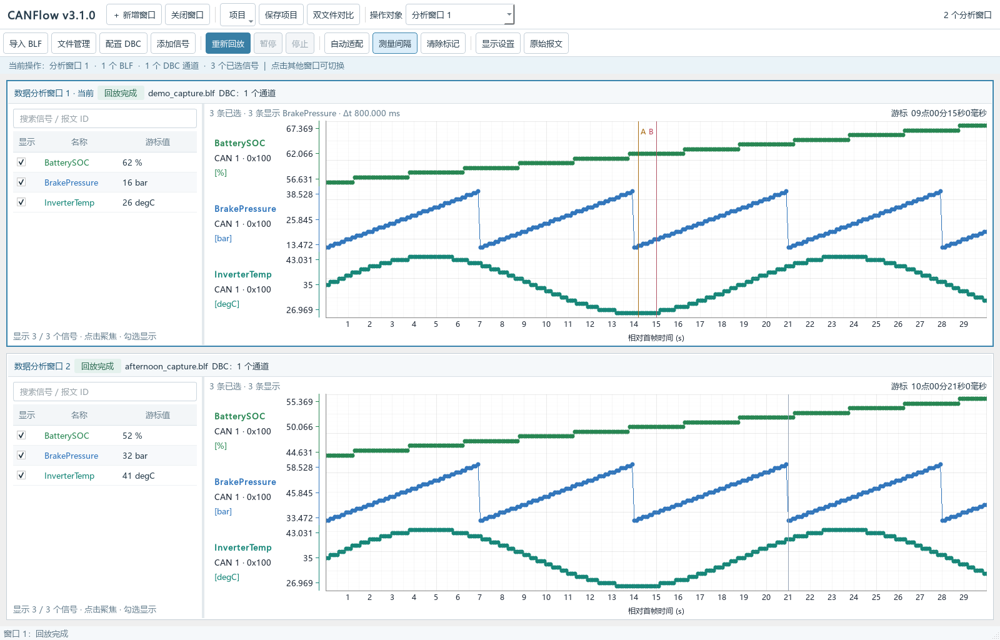

# CANFlow v3.1.0

桌面 BLF 波形回放工具。V3.1 将操作集中到顶部，支持多个独立的分析窗口：每个窗口分别导入 BLF、配置 DBC、选择信号并控制回放。默认打开两个窗口，可按需新增或关闭。浅色信号表与网格波形同时显示，选中的窗口以蓝色边框标识。

保留项目、可复用信号组和多纵轴波形。多选 BLF 后按各文件最早采集时间排序，逐文件快速处理 CAN/CAN FD 数据；波形横轴保留原始采集时间和文件间空白。文件时间范围重叠会在导入时阻止回放。

V3 优化 GiB 级、16 通道密集回放：提前准备解码器、按信号批量写盘、缓存两级峰值概览，并合并界面进度更新。全部解码样本仍保存在磁盘缓存；近距离缩放和游标测量读取原始值。详见 [V3 性能验证](docs/v3-performance.md)。

大文件导入改用完整元数据扫描，省去逐帧报文对象与时间换算开销，并显示文件级进度；未变化文件复用会话内预检结果。DBC 在后台解析，多个通道共享未变化文件的解析结果，大量信号分批显示。详见 [导入性能验证](docs/import-performance.md)。



截图来自正式 PySide6 程序，使用两份生成的示例 CAN 记录，实际解码、回放与测量。

## 启动

需要 Python 3.10 或更新版本。在项目目录执行：

```powershell
python -m venv .venv
.venv\Scripts\python.exe -m pip install -r requirements.txt
.venv\Scripts\python.exe run.py
```

无需安装 Python 时，可从 [Releases](https://github.com/lingPoint/CANFlow/releases) 下载 `CANFlow.exe`。版本标签（如 `v3.0.1`）会触发 Windows 测试、打包并发布正式版本；分支提交仍生成以提交 SHA 命名的预发布版本。EXE 不包含 BLF 或 DBC 文件，请自行选择本地记录和配置。

开发与测试另装 `requirements-dev.txt`，然后运行 `.venv\Scripts\python.exe -m pytest -q`。
真实 1 GiB BLF 压测默认跳过；在有足够临时磁盘空间时设置 `CANFLOW_TEST_1GB=1` 并运行 `pytest tests/test_large_blf.py -s`。
多通道压测会自行生成 1 GiB 临时 BLF；也可先执行
`.venv\Scripts\python.exe scripts\generate_multichannel_blf.py .test-data\multichannel-1g.blf`
保留这份数据及两份通道 DBC，再设置 `CANFLOW_MULTICHANNEL_BLF` 为该 BLF 的绝对路径复用它。
`.test-data` 不加入 Git，以免仓库携带 1 GiB 二进制文件。

16 通道每帧解码、实际显示 16 条轨道的压力测试：

```powershell
.venv\Scripts\python.exe -m scripts.benchmark_v3 --size-mib 1024 --label v3-run1 --ui
```

结果 JSON、生成数据和界面截图保存在 `.test-data/v3`。重复测量请更换 `--label`，BLF 会复用；需要约 2 GiB 可用磁盘。也可设置 `CANFLOW_TEST_16CH=1` 后单独运行 `pytest tests/test_large_blf.py -k dense_sixteen -s`。

## 使用

1. 点击分析窗口的标题、信号表或波形，或使用顶部“操作对象”选择当前窗口。蓝色边框与“当前”标识表示顶部命令的作用对象。使用“新增窗口”“关闭窗口”管理窗口；至少保留一个，多窗口超出屏幕时可滚动。
2. 点击顶部“导入 BLF”选择该窗口的记录。后台完整预检时间范围和通道；“停止”可取消。导入失败或取消保留已有文件。“文件管理”查看当前列表或清空记录。
3. 点击“配置 DBC”，选中 CAN 通道后指定 DBC，也可在没有 BLF 时先新增通道。任务运行时需先停止再修改映射。各窗口可以使用不同 DBC 解码同一个通道。
4. 点击“添加信号”，搜索并勾选，立即生效。信号组支持保存、替换、追加、导入、导出，所有窗口共享信号组库。配置面板属于打开它的分析窗口；打开配置时波形画布仍保留。
5. 点击顶部“开始回放”，使用“暂停 / 继续”和“停止”控制当前窗口；其他窗口可独立同时处理。无 DBC 时仍可回放原始报文。结束后追加信号会自动补画；回放中追加信号会在完成后补画。
6. 左侧显示所有已选信号及游标值，默认显示前 3 条曲线。勾选控制显示，点击信号聚焦；各信号纵轴独立，共享本窗口时间轴。顶部“自动适配”调整视野；“测量间隔”开启后在波形点击两点，标记吸附到真实采样点，结果显示在波形上方。“清除标记”只作用于当前窗口。
7. 顶部“显示设置”调整时间格式、主题、网格、采样点粗细、Y 轴锁定、跟随播放及窗口长度。Ctrl + 滚轮同步缩放可见轨道纵轴。“原始报文”打开该窗口最近 1000 条报文与进度、时间定位面板。波形下方不再放置回放或测量控制。
8. “项目”菜单打开、保存当前分析窗口的 DBC 映射和信号选择。每个窗口可以有自己的项目文件；未命名窗口修改配置也会提示保存。关闭整个软件前逐个检查未保存项目，任一个取消都会保留全部分析窗口。关闭单个窗口会停止其后台任务并清理它的临时缓存。

快捷键：Ctrl+Shift+N 新增分析窗口，Ctrl+W 关闭当前窗口，Ctrl+Tab 切换窗口；Ctrl+N 新建当前窗口项目，Ctrl+O 打开项目，Ctrl+S 保存，Ctrl+Shift+S 另存为。

### 双文件片段对比

点击顶部“双文件对比”，分别选择 A、B 的 BLF。预检后会显示本地采集时间范围；编辑各自的起点和终点（也可输入 Unix 秒数）。分别为所需通道选择 DBC，然后在两侧选择信号并点击“添加信号配对”，可重复添加多组。点击“开始对比”后，两段按各自起点对齐，较短片段结束后留空；滚轮缩放、拖动画布平移，移动鼠标可读取两侧附近的原始采样值与采集时间。单位不同时两侧使用独立纵轴，请结合刻度判断。修改 DBC 需重新配对，修改时间或配对后需重新开始对比。对比仅保存在当前窗口，关闭窗口会清理临时缓存。

项目文件扩展名为 `.canflow.json`。程序优先使用相对 DBC 路径，并保留绝对路径作为后备；DBC 缺失或定义发生变化时会保留未解析信号并提示用户重新配置。独立信号组文件使用 `.canflow-signals.json`。

信号点缓存放在系统临时目录，退出程序时清理。波形按视野抽样绘制，原始信号点保存在 SQLite 临时缓存中。

## 许可

CANFlow 源码公开，按 [PolyForm Noncommercial License 1.0.0](LICENSE.md) 授权，仅允许许可证规定的非商业用途。商业使用需要另行取得仓库所有者的许可。此许可证不是 OSI 开源许可证。

## 当前限制

- 原始报文表显示最近 1000 条，供查看通道和数据；完整 BLF 始终保留在原文件中。
- 同一 BLF 内的多通道报文即使时间戳不按文件顺序递增，也可按原始文件顺序回放；波形保留每帧的采集时间。跨文件的采集时间范围重叠仍会在导入时阻止回放。
- 多窗口布局、BLF 文件列表、测量标记不写入项目，重启后需重新导入记录；现有项目文件格式保持兼容。
- 多窗口并行处理会增加磁盘和内存负载；尚未完成多个 GiB 级文件同时回放的压力验证。
- 曲线数量没有硬限制；大量曲线同时显示时会分批刷新，实际流畅度取决于机器性能和可见时间范围。
